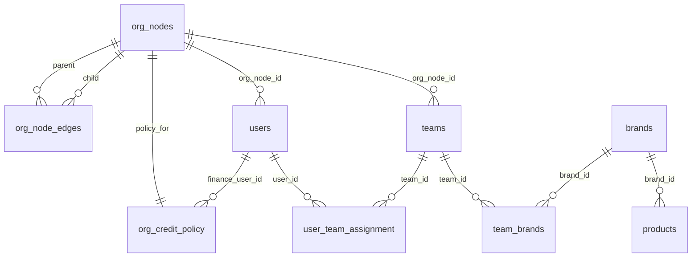

## Definitions Module – End-to-End Guide

This document covers the **Definitions** area of the admin panel (Node.js/Express, EJS, PostgreSQL, RTL/Persian UI). It is intended as a guardrail so future changes do not break the module.

### Contents
- [Scope & entry points](#scope--entry-points)
- [Navigation & flows](#navigation--flows)
- [Route inventory](#route-inventory)
- [Service layer](#service-layer)
- [Views & partials](#views--partials)
- [Static assets (CSS) & UI structure](#static-assets-css--ui-structure)
- [Database inventory & ERD](#database-inventory--erd)
- [Where to change safely](#where-to-change-safely)
- [Regression-prevention checklist](#regression-prevention-checklist)
- [Smoke tests](#smoke-tests)
- [Assumptions](#assumptions)

---

### Scope & entry points
- Admin area lives under `/admin` with `adminSession` + `requireSystemAdmin` middleware (see `src/app.js`).
- Definitions home: `GET /admin/definitions` → `views/definitions/index.ejs`.
- Modules inside definitions:
  - Teams, Team Members, Team Brands
  - Brands
  - Products (including import)
  - Hierarchy (org_nodes) + Arrange (org_node_edges)
  - Credit Policy per org node
  - Users (basic identity edits)
  - Legacy/removed: Baskets (redirect only), org-nodes legacy redirect

---

### Navigation & flows

#### High-level definitions navigation
```mermaid
flowchart TD
  login([/admin/login]) --> defs[/admin/definitions]
  defs --> teams[/admin/definitions/teams]
  defs --> brands[/admin/definitions/brands]
  defs --> products[/admin/definitions/products]
  defs --> hierarchy[/admin/definitions/hierarchy]
  hierarchy --> arrange[/admin/definitions/hierarchy/arrange]
  defs --> credit[/admin/definitions/credit-policy]
  defs --> users[/admin/definitions/users]
  defs --> legacy[legacy baskets\nredirected/disabled]
```

#### Teams definition flow (list → detail → members/brands)
```mermaid
flowchart TD
  T0[/teams list\nGET /admin/definitions/teams/] --> T1{Create/Edit?}
  T1 -->|new| T2[/team form\nGET /teams/new]
  T1 -->|edit| T3[/team form\nGET /teams/:id/edit]
  T2 & T3 --> T4[POST create/update]
  T4 --> T0
  T0 --> TM[/members page\nGET /teams/:id/members]
  TM --> TMA[POST add member]
  TM --> TMR[POST remove member]
  T0 --> TB[/team brands\nGET /teams/:id/brands]
  TB --> TBA[POST add brand]
  TB --> TBR[POST remove brand]
```

#### Hierarchy arrange flow
```mermaid
flowchart TD
  H1[/define titles\nGET/POST /hierarchy] --> H2[/arrange edges\nGET /hierarchy/arrange]
  H2 --> H3[POST /hierarchy/link\nset parent_id]
  H3 --> H2
  H2 --> H4{Loop or FK violation?}
  H4 --yes--> H5[redirect with error]
  H4 --no--> H6[redirect with ok]
```

---

### Route inventory
| URL | Methods | Middleware | Handler file | Notes |
| --- | --- | --- | --- | --- |
| `/admin/definitions` | GET | `adminSession`, `requireSystemAdmin`, `requireLogin`, `enforceRole`, `enforceStatus` | `src/routes/admin.js` | Definitions landing, shows warnings |
| `/admin/definitions/hierarchy` | GET/POST | same as above | `src/routes/admin.js` | Create/edit/delete org_nodes titles |
| `/admin/definitions/hierarchy/update` | POST | same as above | `src/routes/admin.js` | Update title only |
| `/admin/definitions/hierarchy/delete` | POST | same as above | `src/routes/admin.js` | Delete node (checks children/users) |
| `/admin/definitions/hierarchy/arrange` | GET | same | `src/routes/admin.js` | View nodes + edges |
| `/admin/definitions/hierarchy/link` | POST | same | `src/routes/admin.js` | Update parent_id with loop check |
| `/admin/definitions/org-nodes*` | ALL | `adminSession`, `requireSystemAdmin` | `src/routes/orgNodes.routes.js` | 301 redirect to hierarchy (legacy wildcard fixed) |
| `/admin/definitions/baskets` | GET | same | `src/routes/admin.js` | Redirects with “removed” warning |
| `/admin/definitions/baskets/:id/delete` | POST | same | `src/routes/admin.js` | Redirects with “removed” warning |
| `/admin/definitions/brands` | GET | `adminSession`, `requireSystemAdmin`, `ensureSystemAdmin` | `src/routes/brands.definitions.routes.js` | List brands with counts |
| `/admin/definitions/brands/new` | GET | same | `brands.definitions.routes.js` | Create form |
| `/admin/definitions/brands/:id/edit` | GET | same | `brands.definitions.routes.js` | Edit form |
| `/admin/definitions/brands` | POST | same | `brands.definitions.routes.js` | Create brand |
| `/admin/definitions/brands/:id` | POST | same | `brands.definitions.routes.js` | Update brand |
| `/admin/definitions/brands/:id/toggle` | POST | same | `brands.definitions.routes.js` | Toggle active, warns if products exist |
| `/admin/definitions/products` | GET | `adminSession`, `requireSystemAdmin`, `ensureSystemAdmin` | `products.definitions.routes.js` | List/filter products, pagination, import result |
| `/admin/definitions/products/template.xlsx` | GET | same | `products.definitions.routes.js` | Download import template |
| `/admin/definitions/products/template` | GET | same | `products.definitions.routes.js` | Redirect to `.xlsx` |
| `/admin/definitions/products/import` | POST (multer) | same | `products.definitions.routes.js` | XLSX/CSV import, optional brand auto-create |
| `/admin/definitions/products/new` | GET | same | `products.definitions.routes.js` | Create product form |
| `/admin/definitions/products/:id/edit` | GET | same | `products.definitions.routes.js` | Edit product form |
| `/admin/definitions/products` | POST | same | `products.definitions.routes.js` | Create product |
| `/admin/definitions/products/:id` | POST | same | `products.definitions.routes.js` | Update product |
| `/admin/definitions/products/:id/toggle` | POST | same | `products.definitions.routes.js` | Toggle active |
| `/admin/definitions/teams` | GET | `adminSession`, `requireSystemAdmin`, `ensureSystemAdmin` | `teams.definitions.routes.js` | List teams with member/brand counts |
| `/admin/definitions/teams/new` | GET | same | `teams.definitions.routes.js` | Create form |
| `/admin/definitions/teams/:id/edit` | GET | same | `teams.definitions.routes.js` | Edit form |
| `/admin/definitions/teams` | POST | same | `teams.definitions.routes.js` | Create team |
| `/admin/definitions/teams/:id` | POST | same | `teams.definitions.routes.js` | Update team |
| `/admin/definitions/teams/:id/toggle` | POST | same | `teams.definitions.routes.js` | Toggle active |
| `/admin/definitions/teams/:id/delete` | POST | same | `teams.definitions.routes.js` | Delete team (FK-safe) |
| `/admin/definitions/teams/:id/members` | GET | same | `teams.definitions.routes.js` | List team members |
| `/admin/definitions/teams/:id/members/candidates` | GET | same | `teams.definitions.routes.js` | Search candidate users (JSON) |
| `/admin/definitions/teams/:id/members/add` | POST | same | `teams.definitions.routes.js` | Add member (UUID validation, conflict codes) |
| `/admin/definitions/teams/:id/members/remove` | POST | same | `teams.definitions.routes.js` | Remove member |
| `/admin/definitions/teams/:id/brands` | GET | same | `teams.definitions.routes.js` | List brands assigned to team |
| `/admin/definitions/teams/:id/brands/add` | POST | same | `teams.definitions.routes.js` | Add brand to team |
| `/admin/definitions/teams/:id/brands/remove` | POST | same | `teams.definitions.routes.js` | Remove brand from team |
| `/admin/definitions/credit-policy` | GET | `adminSession`, `requireSystemAdmin`, `ensureSystemAdmin` | `creditPolicy.definitions.routes.js` | List org credit policies |
| `/admin/definitions/credit-policy/:nodeId` | GET | same | `creditPolicy.definitions.routes.js` | Edit form for node |
| `/admin/definitions/credit-policy/:nodeId` | POST | same | `creditPolicy.definitions.routes.js` | Upsert policy |
| `/admin/definitions/users` | GET | `adminSession`, `requireSystemAdmin`, `ensureSystemAdmin` | `adminUsers.definitions.routes.js` | List users + org title |
| `/admin/definitions/users/:id/edit` | GET | same | `adminUsers.definitions.routes.js` | Edit user form |
| `/admin/definitions/users/:id` | POST | same | `adminUsers.definitions.routes.js` | Update user (role/status/active/org node) |

---

### Service layer
- **Teams (`src/services/teams.service.js`)**
  - `listTeamsWithCounts()`, `getTeamById()`, `isNameTaken()`, `createTeam()`, `updateTeam()`, `toggleTeamActive()`, `deleteTeam()`
  - Membership: `listTeamMembers()`, `addMember()`, `removeMember()`, `listCandidateUsers()` (manager hierarchy-aware), `normalizeUserId()`
  - Brands: `listTeamBrands()`, `addTeamBrand()`, `removeTeamBrand()`, `listActiveBrandsSimple()`
  - Org nodes: `listOrgNodes()`; uses `queryWithTimeout` to avoid long-running SQL.
- **Brands (`src/services/brands.service.js`)**
  - `listBrandsWithCounts()`, `getBrandById()`, `isNameTaken()`, `isCodeTaken()`, `createBrand()`, `updateBrand()`, `toggleBrandActive()`, `countProducts()`
  - Helpers for selects: `listActiveUsersForManagerSelect()`, `listAllBrandsSimple()`, `listActiveBrands()`.
- **Products (`src/services/products.service.js`)**
  - `listProducts({ brandId, search, page, pageSize })`
  - `getProductById()`, `isSkuTaken()`, `isNameTaken()`, `createProduct()`, `updateProduct()`, `toggleProductActive()`
  - Bulk import: `getProductsBySkuCodes()`, `upsertProducts(rows)`; supports alias arrays and key flag.
- **Credit Policy (`creditPolicy.definitions.routes.js` + `pool`)**
  - Uses direct SQL: `org_credit_policy` table keyed by `org_node_id`; selects approver nodes, finance user, max invoice thresholds.
- **Users (`src/services/users.service.js`)**
  - `listUsersWithOrgTitle()`, `getUserById()`, `listOrgNodes()`, `listDistinctRoles()/Statuses()`, `updateUserDefinitions()`; applies to definitions users page.
- **Shared DB helpers**
  - `queryWithTimeout` in `teams.service` wraps per-query statement_timeout.
  - Guards: `requireSystemAdmin` middleware (`src/middlewares/systemAdmin.js`) plus `requireLogin/enforceRole/enforceStatus` (`src/middlewares/auth`, `guards`).

---

### Views & partials
- Main center: `src/views/definitions/index.ejs` (mobile layout + menu).
- Teams: `definitions/teams.ejs`, `admin_def_team_form.ejs`, `admin_def_team_members.ejs`, `admin_def_team_brands.ejs`.
- Brands: `definitions/brands.ejs`, `admin_def_brand_form.ejs`.
- Products: `definitions/products.ejs`, `admin_def_product_form.ejs`.
- Hierarchy: `admin_hierarchy.ejs`, `admin_hierarchy_arrange.ejs`.
- Credit policy: `admin_def_credit_policy.ejs`, `admin_def_credit_policy_form.ejs`.
- Users: `admin_def_users.ejs`, `admin_def_user_edit.ejs`.
- Layouts/partials: `partials/layout_mobile.ejs`, `partials/pages/admin_definitions.ejs`, `partials/pages/admin_def_*` for per-section content.

---

### Static assets (CSS) & UI structure
- Global/admin themes: `src/public/css/app-mobile.css`, `admin-ui.css`, `admin-theme.css`, `bria-theme.css`.
- Definitions-specific pages: `src/public/css/pages/admin_definitions.css`, `admin_def_brands.css`, `admin_def_products.css`, `admin_def_baskets.css`.
- Typical load order (from layout_mobile): base mobile/theme CSS first, then page-level stylesheet (per EJS). Keep RTL classes consistent; definitions pages rely on `.page--definitions-*`, `.card`, `.btn-primary`, `.table` patterns.
- Ongoing cleanup: admin definitions CSS is being unified—prefer reusing shared classes instead of adding new standalone selectors.

---

### Database inventory & ERD

**Tables referenced (inferred from code):**
- `org_nodes` (id, title, parent_id, level?, branch) – hierarchy titles.
- `org_node_edges` (child_id, parent_id) – derived edges; used for arrange view.
- `org_credit_policy` (org_node_id PK, approver1_node_id, approver2_node_id, finance_required, finance_user_id, max_open_invoices_per_user, max_open_amount_per_user, max_open_invoices_per_customer, max_open_amount_per_customer, max_invoice_amount).
- `teams` (id, name, active, org_node_id?, timestamps).
- `user_team_assignment` (team_id, user_id, created_at, updated_at).
- `team_brands` (team_id, brand_id, priority?).
- `brands` (id, name, code nullable, is_active, manager_user_id).
- `products` (id, brand_id, sku_code nullable, name, aliases, is_key, is_active).
- `users` (id UUID, username, first_name, last_name, phone, status, role, active, org_node_id, manager_id).
- `user_confirmations` (confirmed_by_node_id) – only checked on hierarchy delete guard.

**Relationships (ERD):**


**Indexes/constraints (inferred):**
- Likely unique on `org_nodes.title` (duplicate errors handled).
- Brands enforce unique `code` (nullable) and `name` (case-insensitive checks).
- Products enforce unique `sku_code` and unique (brand_id, name) pair (checked in services).
- `org_credit_policy.org_node_id` treated as PK with `ON CONFLICT` upsert.
- FK protections checked in code: cannot delete org_node with children/users/confirmations; team delete guarded by DB constraint errors.

---

### Where to change safely
- **Teams**: `src/routes/teams.definitions.routes.js`, `src/services/teams.service.js`, views `definitions/teams.ejs`, `admin_def_team_form.ejs`, `admin_def_team_members.ejs`, `admin_def_team_brands.ejs`.
- **Brands**: `src/routes/brands.definitions.routes.js`, `src/services/brands.service.js`, views `definitions/brands.ejs`, `admin_def_brand_form.ejs`.
- **Products**: `src/routes/products.definitions.routes.js`, `src/services/products.service.js`, views `definitions/products.ejs`, `admin_def_product_form.ejs`.
- **Hierarchy**: `src/routes/admin.js` (hierarchy + arrange), views `admin_hierarchy*.ejs`.
- **Credit policy**: `src/routes/creditPolicy.definitions.routes.js`, views `admin_def_credit_policy*.ejs`.
- **Users (definitions)**: `src/routes/adminUsers.definitions.routes.js`, views `admin_def_users.ejs`, `admin_def_user_edit.ejs`.
- **CSS**: `src/public/css/pages/admin_def*.css` (prefer reusing shared classes in `admin-theme.css`).
- Dangerous patterns to avoid:
  - **Express wildcard**: do **not** register `/path*` style routes (path-to-regexp crash). Use explicit params like `/path/:rest(*)` or regex routes. Legacy `/definitions/org-nodes*` is handled via redirect file.
  - **SQL placeholders**: always use parameterized queries; avoid mixing `$1` with templated strings that concatenate values (prior regressions caused “syntax error near "$1"”).

---

### Regression-prevention checklist
- [ ] No routes using bare `*` wildcards under `/admin/definitions` (search for `org-nodes*` patterns).
- [ ] All SQL uses parameter binding (`$1` etc.) without string concatenation of user input.
- [ ] Hierarchy arrange rejects cycles; keep `parent_id` updates only via `/hierarchy/link`.
- [ ] Team member add/remove validates UUIDs and conflict codes.
- [ ] Brand/product forms respect active flags and duplicate checks.
- [ ] Credit policy requires approver1 and (if finance_required) finance user.
- [ ] Views continue to use RTL-friendly classes; avoid breaking `layout_mobile`.
- [ ] Keep import limits (≤5000 rows, 10MB file) and header order intact.

---

### Smoke tests
Run after changes (replace host if needed):
```sh
# Restart & port check
pm2 restart toinfinity
ss -lntp | grep :3000

# Basic availability
curl -I http://localhost:3000/admin/login
curl -I http://localhost:3000/admin/definitions
curl -I http://localhost:3000/admin/definitions/teams
curl -I http://localhost:3000/admin/definitions/hierarchy

# Ensure wildcard regression is absent
rg "org-nodes\\*" src/routes

# Optional quick service sanity (node REPL/snippet)
node -e "const svc=require('./src/services/teams.service'); svc.listTeamsWithCounts().then(r=>{console.log('teams',r.length);}).catch(e=>console.error(e.message));"
```

---

### Assumptions
- Exact DB indexes are inferred from code paths and error handling; confirm against schema when migrations are available.
- CSS load order follows `layout_mobile` (base theme before per-page); adjust if layout changes.
- `org_node_edges` table exists via DB triggers; arrange page tolerates missing table gracefully.

