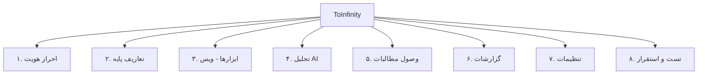
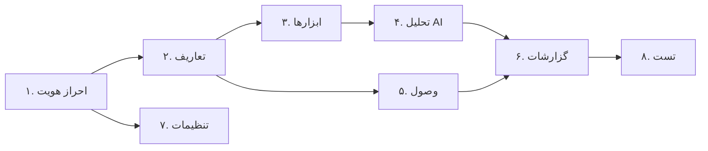

# ساختار شکست کار (WBS)
# سیستم ToInfinity

## نسخه ۱.۰

---

## ۱. سطح اول: فازهای اصلی پروژه

---

## ۲. ساختار سه‌سطحی WBS

### ۱. احراز هویت (Authentication)

#### ۱.۱ ربات تلگرام
- ۱.۱.۱ نصب و پیکربندی ربات
- ۱.۱.۲ پیاده‌سازی /start command
- ۱.۱.۳ دریافت telegram_id
- ۱.۱.۴ تست getMe
- ۱.۱.۵ Webhook setup

#### ۱.۲ مدیریت سشن
- ۱.۲.۱ تولید JWT token
- ۱.۲.۲ Refresh token mechanism
- ۱.۲.۳ ذخیره session در Redis/Memory
- ۱.۲.۴ Logout و Invalidate

#### ۱.۳ ثبت‌نام و تأیید
- ۱.۳.۱ ثبت‌نام ادمین اولیه
- ۱.۳.۲ ثبت‌نام کاربران عادی
- ۱.۳.۳ فرآیند تأیید مدیر
- ۱.۳.۴ نوتیفیکیشن تأیید

#### ۱.۴ انتخاب زبان
- ۱.۴.۱ صفحه انتخاب زبان (فارسی، انگلیسی، عربی)
- ۱.۴.۲ ذخیره در localStorage
- ۱.۴.۳ ذخیره در cookie
- ۱.۴.۴ اعمال به UI

---

### ۲. تعاریف پایه (Definitions Module)

#### ۲.۱ سلسله مراتب سازمانی
- ۲.۱.۱ ایجاد درخت سازمانی
- ۲.۱.۲ CRUD رده‌ها
- ۲.۱.۳ چک زیرمجموعه برای حذف
- ۲.۱.۴ تنظیم requires_credit_approval
- ۲.۱.۵ UI نمایش درختی

#### ۲.۲ مدیریت کالا
- ۲.۲.۱ گروه کالا (CRUD)
- ۲.۲.۲ برندها (CRUD)
- ۲.۲.۳ کالاهای استراتژیک
  - ۲.۲.۳.۱ CRUD کالاها
  - ۲.۲.۳.۲ آپلود ویس نمونه
  - ۲.۲.۳.۳ آپلود موجودی از Excel
  - ۲.۲.۳.۴ تنظیم فاصله GPS

#### ۲.۳ مدیریت مشتری
- ۲.۳.۱ صنف مشتری (CRUD)
- ۲.۳.۲ مشتریان (CRUD)
- ۲.۳.۳ ذخیره GPS
- ۲.۳.۴ تبدیل GPS به آدرس (AI)
- ۲.۳.۵ قفل اعتباری

#### ۲.۴ ایمپورت/اکسپورت
- ۲.۴.۱ ایمپورت Excel
- ۲.۴.۲ اکسپورت Excel
- ۲.۴.۳ Validation داده‌ها
- ۲.۴.۴ خطایابی

---

### ۳. ابزارها - ضبط و پردازش ویس

#### ۳.۱ فرم پیش از ضبط
- ۳.۱.۱ فیلد نام مشتری (تایپی)
- ۳.۱.۲ فیلد صنف (کشویی)
- ۳.۱.۳ Validation اجباری
- ۳.۱.۴ غیرفعال‌سازی دکمه ضبط

#### ۳.۲ ضبط ویس
- ۳.۲.۱ درخواست مجوز میکروفون
- ۳.۲.۲ شروع ضبط
- ۳.۲.۳ نمایش timer
- ۳.۲.۴ توقف ضبط
- ۳.۲.۵ هشدار ویس طولانی (>۳۰ دقیقه)

#### ۳.۳ GPS و موقعیت
- ۳.۳.۱ درخواست مجوز GPS
- ۳.۳.۲ دریافت lat, lng, accuracy
- ۳.۳.۳ چک دقت GPS (<۱۰ متر)
- ۳.۳.۴ ورود دستی در صورت خطا
- ۳.۳.۵ لینک گوگل مپ

#### ۳.۴ آدرس AI از GPS
- ۳.۴.۱ فراخوانی Reverse Geocoding API
- ۳.۴.۲ تبدیل به آدرس متنی
- ۳.۴.۳ ذخیره در جدول customers
- ۳.۴.۴ نمایش به کاربر

#### ۳.۵ شناسایی صدا
- ۳.۵.۱ مقایسه با voice_signature
- ۳.۵.۲ تأیید یا رد
- ۳.۵.۳ خطا در صورت عدم مطابقت

#### ۳.۶ آفلاین Sync
- ۳.۶.۱ ذخیره در localStorage
- ۳.۶.۲ تشخیص آنلاین شدن
- ۳.۶.۳ ارسال صف (Queue)
- ۳.۶.۴ Retry ۳ بار
- ۳.۶.۵ Chunk برای ویس‌های بزرگ

#### ۳.۷ فوروارد تلگرام
- ۳.۷.۱ آماده‌سازی متادیتا
- ۳.۷.۲ فوروارد به مدیر
- ۳.۷.۳ Fallback به ایمیل
- ۳.۷.۴ تأیید ارسال

#### ۳.۸ ذخیره متادیتا
- ۳.۸.۱ استخراج کلمات کلیدی
- ۳.۸.۲ ذخیره در voice_logs
- ۳.۸.۳ بدون ذخیره فایل ویس

---

### ۴. تحلیل هوش مصنوعی (AI Voice Analysis)

#### ۴.۱ اتصال به API
- ۴.۱.۱ پیکربندی API Keys
- ۴.۱.۲ پیکربندی Base URLs
- ۴.۱.۳ تست اتصال
- ۴.۱.۴ مدیریت خطا

#### ۴.۲ موضوعات تحلیل
- ۴.۲.۱ کلام
  - ۴.۲.۱.۱ تحلیل ۲+۲+۲ دقیقه
  - ۴.۲.۱.۲ نمره‌دهی واژگان
  - ۴.۲.۱.۳ نمره ساختار جملات
- ۴.۲.۲ لحن
  - ۴.۲.۲.۱ تشخیص تن صدا
  - ۴.۲.۲.۲ سنجش هیجان/آرامش
- ۴.۲.۳ استرس
  - ۴.۲.۳.۱ تحلیل سطح استرس
  - ۴.۲.۳.۲ نمره‌دهی
- ۴.۲.۴ تکنیک‌های فروش
  - ۴.۲.۴.۱ شناسایی Upselling
  - ۴.۲.۴.۲ Handling Objection
  - ۴.۲.۴.۳ سرعت ۲x
- ۴.۲.۵ جملات منفی
  - ۴.۲.۵.۱ شناسایی عبارات منفی
  - ۴.۲.۵.۲ شمارش
- ۴.۲.۶ کالاهای استراتژیک
  - ۴.۲.۶.۱ مقایسه با voice_sample
  - ۴.۲.۶.۲ تشخیص فراموشی
  - ۴.۲.۶.۳ فرصت ۶-۷ روزه

#### ۴.۳ پرامپت‌های AI
- ۴.۳.۱ پرامپت سطح ساده
- ۴.۳.۲ پرامپت سطح معمولی
- ۴.۳.۳ پرامپت سطح سخت
- ۴.۳.۴ ویرایش توسط ادمین

#### ۴.۴ نمره‌دهی
- ۴.۴.۱ محاسبه نمره ۰-۱۰۰
- ۴.۴.۲ نمره جزئی هر موضوع
- ۴.۴.۳ نمره کلی
- ۴.۴.۴ ذخیره در analysis_json

#### ۴.۵ سطح‌بندی
- ۴.۵.۱ محاسبه سطح (آماتور/نیمه/حرفه‌ای)
- ۴.۵.۲ بروزرسانی level کاربر
- ۴.۵.۳ نمایش در داشبورد

#### ۴.۶ تمرین‌های روزانه
- ۴.۶.۱ شناسایی نقاط ضعف
- ۴.۶.۲ اولویت‌بندی (۱-۶)
- ۴.۶.۳ تعیین تمرین‌ها (۳-۵ تا)
- ۴.۶.۴ فقط اولویت اول
- ۴.۶.۵ مدت تمرکز (مثلاً ۷ روز)

#### ۴.۷ نوتیفیکیشن پیشرفت
- ۴.۷.۱ track پیشرفت روزانه
- ۴.۷.۲ چک ۳ روز بعد از تمام شدن
- ۴.۷.۳ نوتیفیکیشن به مدیر اگر پیشرفت نداشت

#### ۴.۸ بودجه API
- ۴.۸.۱ محاسبه هزینه
- ۴.۸.۲ مقایسه با بودجه ماهانه
- ۴.۸.۳ هشدار نزدیک به سقف
- ۴.۸.۴ توقف اگر تمام شد

---

### ۵. وصول مطالبات (Credit Management)

#### ۵.۱ درخواست اعتباری
- ۵.۱.۱ فرم درخواست
  - ۵.۱.۱.۱ کد مشتری (تایپی + چک)
  - ۵.۱.۱.۲ مبلغ
  - ۵.۱.۱.۳ تاریخ تسویه
  - ۵.۱.۱.۴ انتخاب ضامن
- ۵.۱.۲ چک بدهی قبلی
- ۵.۱.۳ خطا اگر بدهکار
- ۵.۱.۴ ثبت با status='pending'

#### ۵.۲ تأیید رده‌ای
- ۵.۲.۱ یافتن رده‌های requires_credit_approval
- ۵.۲.۲ ترتیب رده‌ها
- ۵.۲.۳ ارسال به رده بعدی
- ۵.۲.۴ تأیید با ویس/چک‌باکس
- ۵.۲.۵ بروزرسانی confirmations_json

#### ۵.۳ تولید فاکتور
- ۵.۳.۱ بعد از تأیید نهایی
- ۵.۳.۲ فرمت FAC-۲۰۲۵-۰۰۱۲۳
- ۵.۳.۳ ثبت در credit_requests
- ۵.۳.۴ نوتیفیکیشن به فروشنده

#### ۵.۴ مدیریت مانده
- ۵.۴.۱ ورود مانده از اپ
- ۵.۴.۲ ایمپورت از Excel
- ۵.۴.۳ بروزرسانی زنده
- ۵.۴.۴ نمایش در گزارشات

#### ۵.۵ خروج مانده
- ۵.۵.۱ فرم درخواست خروج
- ۵.۵.۲ انتخاب دلیل
- ۵.۵.۳ ارسال به حسابدار
- ۵.۵.۴ تأیید و حذف

#### ۵.۶ نوتیفیکیشن‌های مالی
- ۵.۶.۱ مانده بیش از اعتبار
- ۵.۶.۲ مانده معوق
- ۵.۶.۳ مسدودی حساب
- ۵.۶.۴ هشدار به مدیر
- ۵.۶.۵ ارسال PWA + تلگرام

---

### ۶. گزارشات (Reporting)

#### ۶.۱ دسته آموزشی
- ۶.۱.۱ نقاط ضعف
  - ۶.۱.۱.۱ Query از voice_logs
  - ۶.۱.۱.۲ فیلتر سلسله‌مراتبی
  - ۶.۱.۱.۳ نمایش جدولی
- ۶.۱.۲ تمرین‌های فردی
- ۶.۱.۳ کالاهای فراموش‌شده
  - ۶.۱.۳.۱ Query از forgotten_key_products
  - ۶.۱.۳.۲ نوتیفیکیشن GPS
  - ۶.۱.۳.۳ گزارش پیشین
- ۶.۱.۴ عملکرد با مشتری
  - ۶.۱.۴.۱ سرچ نام/صنف/آدرس AI
  - ۶.۱.۴.۲ فیلتر GPS (۳-۵ نزدیک)
  - ۶.۱.۴.۳ خلاصه مذاکرات

#### ۶.۲ دسته ابلاغ‌ها
- ۶.۲.۱ ابلاغات مدیرم
- ۶.۲.۲ درخواست‌های پرسنلم
- ۶.۲.۳ ابلاغات و درخواست‌های من

#### ۶.۳ دسته ارجاعات
- ۶.۳.۱ ارجاعات سازمانی
- ۶.۳.۲ دستورالعمل‌های من

#### ۶.۴ دسته تأییدها
- ۶.۴.۱ تأییدهای مالی
- ۶.۴.۲ مانده فروشنده

#### ۶.۵ خروجی PDF
- ۶.۵.۱ تولید PDF با لوگوی شرکت
- ۶.۵.۲ فقط بخش‌های تیک‌دار
- ۶.۵.۳ ارسال به تلگرام
- ۶.۵.۴ Fallback دانلود مستقیم

---

### ۷. تنظیمات (Settings)

#### ۷.۱ نصب اولیه
- ۷.۱.۱ ویزارد نصب
- ۷.۱.۲ تست دامنه (HTTPS + /health)
- ۷.۱.۳ تست توکن تلگرام (getMe)
- ۷.۱.۴ تست API هوش (پیام ساده)
- ۷.۱.۵ تأیید و شروع

#### ۷.۲ دامنه و توکن
- ۷.۲.۱ ورود/ویرایش دامنه
- ۷.۲.۲ ورود/ویرایش توکن ربات
- ۷.۲.۳ ورود لینک ربات

#### ۷.۳ API هوش مصنوعی
- ۷.۳.۱ لیست موضوعات
- ۷.۳.۲ اضافه/حذف موضوع
- ۷.۳.۳ تنظیم مدل
- ۷.۳.۴ تنظیم API Key
- ۷.۳.۵ تنظیم Base URL
- ۷.۳.۶ ویرایش پرامپت (۳ سطح)
- ۷.۳.۷ بودجه ماهانه

#### ۷.۴ سخت‌گیری
- ۷.۴.۱ انتخاب سطح (ساده/معمولی/سخت)
- ۷.۴.۲ تنظیم برای تیم یا فرد
- ۷.۴.۳ تأثیر بر پرامپت

#### ۷.۵ رده‌های تأیید
- ۷.۵.۱ انتخاب رده‌های اعتباری
- ۷.۵.۲ ترتیب رده‌ها
- ۷.۵.۳ ذخیره تنظیمات

#### ۷.۶ نوتیفیکیشن مانده
- ۷.۶.۱ انتخاب رده‌های دیدن
- ۷.۶.۲ تعداد سطوح بالا (۱-۳)
- ۷.۶.۳ ذخیره

#### ۷.۷ دسترسی‌ها
- ۷.۷.۱ ماتریس دسترسی رده‌ای
- ۷.۷.۲ تیک برای هر بخش
- ۷.۷.۳ تیک خاموش = غیب کامل
- ۷.۷.۴ فقط ادمین اولیه

#### ۷.۸ مشخصات شرکت
- ۷.۸.۱ نام شرکت
- ۷.۸.۲ آپلود لوگو
- ۷.۸.۳ آدرس
- ۷.۸.۴ نمایش در PDF

#### ۷.۹ اولویت‌های آموزشی
- ۷.۹.۱ تعداد تمرین روزانه
- ۷.۹.۲ اولویت موضوعات (۱-۶)
- ۷.۹.۳ مدت تمرکز روز
- ۷.۹.۴ قدم‌به‌قدم

---

### ۸. تست و استقرار (Testing & Deployment)

#### ۸.۱ تست واحد (Unit Testing)
- ۸.۱.۱ تست Backend APIs
- ۸.۱.۲ تست Frontend Components
- ۸.۱.۳ تست Database Queries
- ۸.۱.۴ تست AI Integration

#### ۸.۲ تست یکپارچگی (Integration Testing)
- ۸.۲.۱ تست Telegram Bot
- ۸.۲.۲ تست GPS
- ۸.۲.۳ تست AI Analysis
- ۸.۲.۴ تست آفلاین Sync

#### ۸.۳ تست سیستم (System Testing)
- ۸.۳.۱ تست سناریوهای کامل
- ۸.۳.۲ تست بار (Load Testing)
- ۸.۳.۳ تست امنیت
- ۸.۳.۴ تست مرورگرها

#### ۸.۴ تست پذیرش کاربر (UAT)
- ۸.۴.۱ آموزش کاربران آزمایشی
- ۸.۴.۲ دریافت بازخورد
- ۸.۴.۳ رفع مشکلات
- ۸.۴.۴ تأیید نهایی

#### ۸.۵ استقرار
- ۸.۵.۱ آماده‌سازی سرور
- ۸.۵.۲ نصب PostgreSQL
- ۸.۵.۳ پیکربندی HTTPS
- ۸.۵.۴ Deploy Backend
- ۸.۵.۵ Deploy Frontend (PWA)
- ۸.۵.۶ تنظیم Telegram Bot
- ۸.۵.۷ Monitoring و Logging

#### ۸.۶ مستندسازی
- ۸.۶.۱ راهنمای کاربر
- ۸.۶.۲ راهنمای ادمین
- ۸.۶.۳ مستندات API
- ۸.۶.۴ راهنمای استقرار

---

## ۳. تخمین زمان و منابع

### زمان‌بندی کلی:

| ردیف | فاز | مدت (هفته) | منابع | اولویت |
|------|-----|------------|-------|--------|
| ۱ | احراز هویت | ۲ | ۲ Backend + ۱ Frontend | بحرانی |
| ۲ | تعاریف پایه | ۲ | ۲ Backend + ۱ Frontend | بحرانی |
| ۳ | ابزارها - ویس | ۳ | ۲ Backend + ۲ Frontend | بحرانی |
| ۴ | تحلیل AI | ۴ | ۲ Backend + ۱ AI Specialist | بالا |
| ۵ | وصول مطالبات | ۳ | ۲ Backend + ۱ Frontend | بالا |
| ۶ | گزارشات | ۳ | ۱ Backend + ۱ Frontend | متوسط |
| ۷ | تنظیمات | ۲ | ۱ Backend + ۱ Frontend | متوسط |
| ۸ | تست و استقرار | ۳ | تیم کامل + ۲ Tester | بالا |
| **جمع** | | **۲۲ هفته** | | |

### منابع انسانی مورد نیاز:

- **Backend Developer**: ۲ نفر
- **Frontend Developer**: ۲ نفر
- **AI Specialist**: ۱ نفر
- **UI/UX Designer**: ۱ نفر
- **QA/Tester**: ۲ نفر
- **DevOps**: ۱ نفر
- **Project Manager**: ۱ نفر

---

## ۴. وابستگی‌ها

---

**تاریخ**: ۱۴۰۳/۰۹/۲۱
**نسخه**: ۱.۰
**وضعیت**: نهایی
