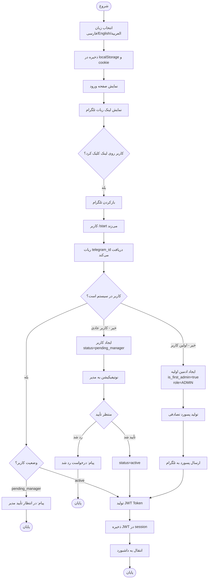
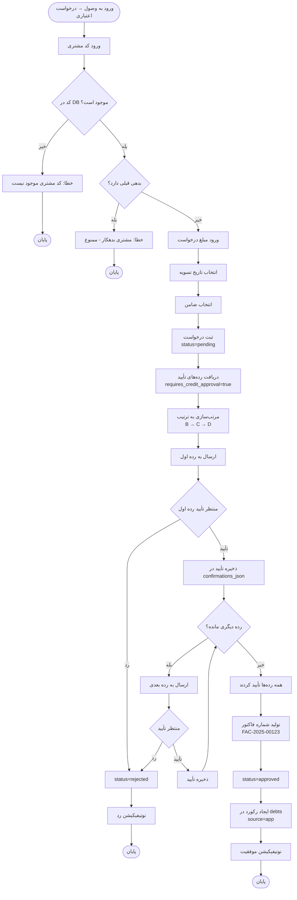
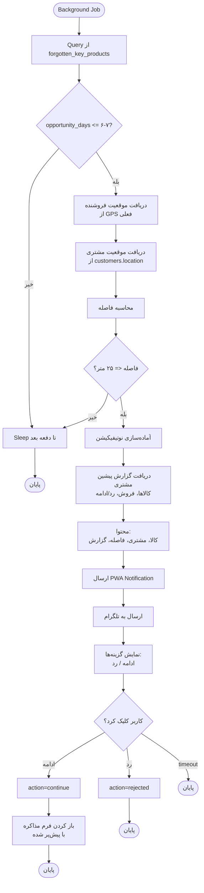
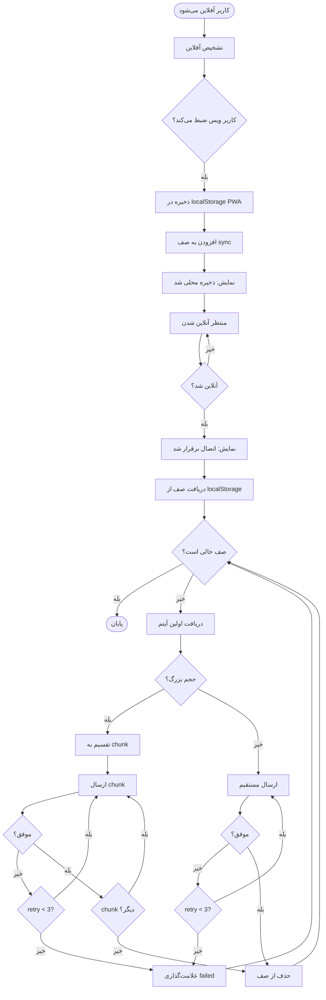
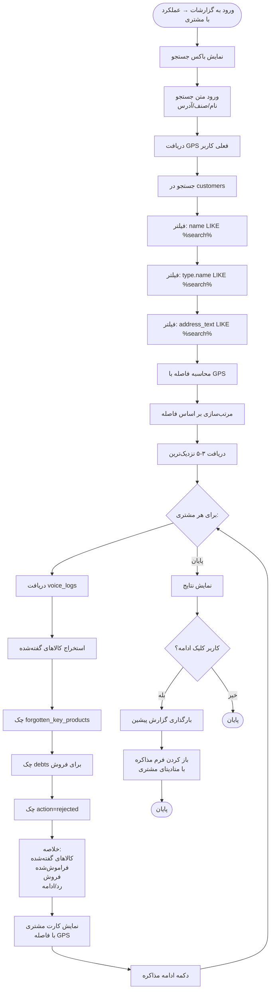

# فلوچارت‌های سیستم ToInfinity

## نسخه ۱.۰

---

## ۱. فلوچارت ورود و احراز هویت

---

## ۲. فلوچارت ضبط ویس مذاکره

```mermaid
flowchart TD
    Start([ورود به ابزارها → مذاکره]) --> ShowForm[نمایش فرم اجباری]
    ShowForm --> EnterCustomer[ورود نام مشتری<br/>متنی - تایپ آزاد]
    EnterCustomer --> SelectCategory[انتخاب صنف مشتری<br/>کشویی]
    
    SelectCategory --> CheckForm{هر دو فیلد پر شد؟}
    CheckForm -->|خیر| DisableBtn[دکمه ضبط غیرفعال<br/>خاکستری]
    DisableBtn --> ShowForm
    
    CheckForm -->|بله| EnableBtn[دکمه ضبط فعال<br/>قرمز]
    EnableBtn --> UserPressRec{کاربر دکمه را فشرد؟}
    
    UserPressRec -->|بله| RequestMic[درخواست مجوز میکروفون]
    RequestMic --> CheckMicPerm{مجوز داده شد؟}
    
    CheckMicPerm -->|خیر| ShowMicError[خطا: مجوز میکروفون نداده شد]
    ShowMicError --> End1([پایان])
    
    CheckMicPerm -->|بله| RequestGPS[درخواست مجوز GPS]
    RequestGPS --> CheckGPSPerm{مجوز GPS؟}
    
    CheckGPSPerm -->|خیر| ManualAddress[گزینه ورود دستی آدرس]
    ManualAddress --> StartRec1[شروع ضبط]
    
    CheckGPSPerm -->|بله| GetGPS[دریافت lat, lng, accuracy]
    GetGPS --> CheckAccuracy{accuracy < 10m?}
    
    CheckAccuracy -->|خیر| ShowGPSWarning[هشدار: دقت GPS پایین]
    ShowGPSWarning --> ManualOption{کاربر ادامه می‌دهد؟}
    ManualOption -->|خیر| ManualAddress
    ManualOption -->|بله| CallReverseGeo[فراخوانی Reverse Geocoding AI]
    
    CheckAccuracy -->|بله| CallReverseGeo
    CallReverseGeo --> GetAddress[دریافت آدرس متنی]
    GetAddress --> StartRec1
    
    StartRec1 --> RecordingLoop{در حال ضبط...}
    RecordingLoop --> CheckTime{بیش از 30 دقیقه؟}
    CheckTime -->|بله| ShowWarning[هشدار: هزینه بالای API]
    ShowWarning --> RecordingLoop
    
    CheckTime -->|خیر| UserStopRec{کاربر توقف کرد؟}
    UserStopRec -->|خیر| RecordingLoop
    
    UserStopRec -->|بله| StopRec[توقف ضبط]
    StopRec --> VoiceID[شناسایی صدا با voice_signature]
    VoiceID --> CheckVoiceMatch{صدا مطابقت دارد؟}
    
    CheckVoiceMatch -->|خیر| ShowVoiceError[خطا: صدا مطابقت ندارد]
    ShowVoiceError --> End2([پایان])
    
    CheckVoiceMatch -->|بله| CheckOnline{آنلاین است؟}
    
    CheckOnline -->|خیر| SaveLocal[ذخیره در localStorage PWA]
    SaveLocal --> QueueSync[افزودن به صف sync]
    QueueSync --> WaitOnline[منتظر آنلاین شدن]
    WaitOnline --> CheckOnline
    
    CheckOnline -->|بله| PrepareMetadata[آماده‌سازی متادیتا<br/>نام، صنف، GPS، زمان]
    PrepareMetadata --> ForwardTelegram[فوروارد به مدیر در تلگرام]
    ForwardTelegram --> CheckTelegramOK{ارسال موفق؟}
    
    CheckTelegramOK -->|خیر| FallbackEmail[Fallback: ارسال به ایمیل]
    FallbackEmail --> ExtractKeywords
    
    CheckTelegramOK -->|بله| ExtractKeywords[استخراج کلمات کلیدی]
    ExtractKeywords --> SaveMetadata[ذخیره متادیتا + کلمات<br/>بدون فایل ویس]
    SaveMetadata --> QueueAI[افزودن به صف تحلیل AI]
    QueueAI --> ShowSuccess[نمایش پیام موفقیت]
    ShowSuccess --> End3([پایان])
```

---

## ۳. فلوچارت تحلیل هوش مصنوعی

```mermaid
flowchart TD
    Start([شروع تحلیل AI]) --> GetFromQueue[دریافت از صف تحلیل]
    GetFromQueue --> CheckBudget{بودجه API باقی مانده؟}
    
    CheckBudget -->|خیر| StopAnalysis[توقف تحلیل]
    StopAnalysis --> NotifyBudget[نوتیفیکیشن: بودجه تمام شد]
    NotifyBudget --> OnlyForward[فقط فوروارد ادامه پیدا می‌کند]
    OnlyForward --> End1([پایان])
    
    CheckBudget -->|بله| GetUserLevel[دریافت سطح کاربر<br/>آماتور/نیمه/حرفه‌ای]
    GetUserLevel --> GetHardness[دریافت سطح سخت‌گیری<br/>ساده/معمولی/سخت]
    GetHardness --> GetTopics[دریافت موضوعات فعال]
    
    GetTopics --> Topic1{کلام فعال؟}
    Topic1 -->|بله| SampleVoice1[sample ۲+۲+۲ دقیقه]
    SampleVoice1 --> GetPrompt1[دریافت پرامپت کلام<br/>بر اساس سخت‌گیری]
    GetPrompt1 --> CallAPI1[فراخوانی AI API]
    CallAPI1 --> GetScore1[نمره ۰-۱۰۰ کلام]
    GetScore1 --> Topic2
    
    Topic1 -->|خیر| Topic2{لحن فعال؟}
    Topic2 -->|بله| SampleVoice2[sample ۲+۲+۲ دقیقه]
    SampleVoice2 --> GetPrompt2[دریافت پرامپت لحن]
    GetPrompt2 --> CallAPI2[فراخوانی AI API]
    CallAPI2 --> GetScore2[نمره ۰-۱۰۰ لحن]
    GetScore2 --> Topic3
    
    Topic2 -->|خیر| Topic3{استرس فعال؟}
    Topic3 -->|بله| AnalyzeStress[تحلیل استرس از صدا]
    AnalyzeStress --> GetScore3[نمره ۰-۱۰۰ استرس]
    GetScore3 --> Topic4
    
    Topic3 -->|خیر| Topic4{تکنیک فروش فعال؟}
    Topic4 -->|بله| SpeedUp[سرعت ۲x]
    SpeedUp --> GetPrompt4[پرامپت تکنیک فروش]
    GetPrompt4 --> CallAPI4[فراخوانی AI]
    CallAPI4 --> GetScore4[نمره ۰-۱۰۰ تکنیک]
    GetScore4 --> Topic5
    
    Topic4 -->|خیر| Topic5{جملات منفی فعال؟}
    Topic5 -->|بله| DetectNegative[شناسایی جملات منفی]
    DetectNegative --> CountNegative[شمارش]
    CountNegative --> GetScore5[نمره ۰-۱۰۰]
    GetScore5 --> Topic6
    
    Topic5 -->|خیر| Topic6{کالای استراتژیک فعال؟}
    Topic6 -->|بله| GetProducts[دریافت کالاهای استراتژیک]
    GetProducts --> CompareVoice[مقایسه با voice_sample]
    CompareVoice --> DetectForgotten[شناسایی فراموشی]
    DetectForgotten --> CalcOpportunity[محاسبه فرصت ۶-۷ روزه]
    CalcOpportunity --> SaveForgotten[ذخیره در forgotten_key_products]
    SaveForgotten --> Topic6End
    
    Topic6 -->|خیر| Topic6End[پایان موضوعات]
    
    Topic6End --> CalcOverall[محاسبه نمره کلی]
    CalcOverall --> DetectWeakness[شناسایی نقاط ضعف]
    DetectWeakness --> PrioritizeWeakness[اولویت‌بندی ۱-۶]
    PrioritizeWeakness --> CreateExercises[ایجاد تمرین‌های روزانه<br/>۳-۵ تا فقط اولویت اول]
    CreateExercises --> SaveAnalysis[ذخیره analysis_json]
    SaveAnalysis --> UpdateLevel[بروزرسانی سطح کاربر]
    UpdateLevel --> NotifyUser[نوتیفیکیشن به کاربر]
    NotifyUser --> End2([پایان])
```

---

## ۴. فلوچارت درخواست اعتباری و تأیید

---

## ۵. فلوچارت نوتیفیکیشن کالاهای فراموش‌شده (GPS)

---

## ۶. فلوچارت آفلاین Sync

---

## ۷. فلوچارت گزارش عملکرد با مشتری (سرچ آدرس AI)

---

**تاریخ**: ۱۴۰۳/۰۹/۲۱
**نسخه**: ۱.۰
**وضعیت**: نهایی
