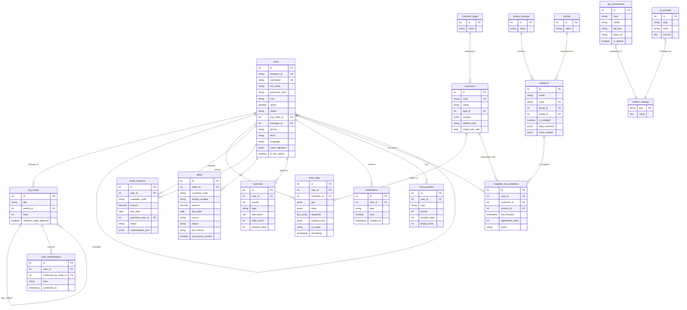

# دیاگرام موجودیت-رابطه (ERD)
# سیستم ToInfinity

## نسخه ۱.۰

---

## ۱. دیاگرام ERD کامل



---

## ۲. روابط جداول

### ۲.۱ رابطه users

| جدول مقصد | نوع رابطه | توضیح |
|-----------|-----------|-------|
| org_nodes | N:1 | هر کاربر به یک رده تعلق دارد |
| users (manager) | N:1 | هر کاربر یک مدیر دارد |
| voice_logs | 1:N | هر کاربر چندین ویس ضبط می‌کند |
| credit_requests | 1:N | هر کاربر چندین درخواست اعتباری دارد |
| debts | 1:N | هر کاربر (فروشنده) چندین مانده دارد |
| exercises | 1:N | هر کاربر چندین تمرین دارد |
| notifications | 1:N | هر کاربر چندین نوتیفیکیشن دریافت می‌کند |

### ۲.۲ رابطه org_nodes

| جدول مقصد | نوع رابطه | توضیح |
|-----------|-----------|-------|
| org_nodes (parent) | N:1 | درخت سلسله‌مراتبی (self-reference) |
| user_confirmations | 1:N | هر رده چندین تأیید می‌کند |

### ۲.۳ رابطه products

| جدول مقصد | نوع رابطه | توضیح |
|-----------|-----------|-------|
| product_groups | N:1 | هر کالا به یک گروه تعلق دارد |
| brands | N:1 | هر کالا به یک برند تعلق دارد |
| forgotten_key_products | 1:N | کالا در چند مورد فراموش می‌شود |

### ۲.۴ رابطه customers

| جدول مقصد | نوع رابطه | توضیح |
|-----------|-----------|-------|
| customer_types | N:1 | هر مشتری به یک صنف تعلق دارد |
| voice_logs | 1:N | هر مشتری چندین مذاکره دارد |
| forgotten_key_products | 1:N | هر مشتری چندین کالای فراموش شده دارد |

---

## ۳. قوانین یکپارچگی

### ۳.۱ Cascade Delete

- **org_nodes**: اگر رده حذف شود، زیرمجموعه‌ها نباید حذف شوند (محدودیت)
- **users**: اگر کاربر حذف شود، voice_logs نباید حذف شوند (نگه‌داری تاریخچه)
- **products**: اگر کالا حذف شود، forgotten_key_products حذف می‌شوند

### ۳.۲ Cascade Update

- **کد مشتری**: اگر تغییر کند، در debts و credit_requests بروز شود

### ۳.۳ محدودیت‌ها

- **users.telegram_id**: UNIQUE
- **users.username**: UNIQUE
- **products.code**: UNIQUE
- **customers.code**: UNIQUE
- **org_nodes**: parent_id نمی‌تواند خودش باشد (جلوگیری از حلقه)
- **users.manager_id**: نمی‌تواند خودش باشد

---

## ۴. Index‌ها

### ۴.۱ Primary Keys
- همه جداول دارای id به عنوان PK

### ۴.۲ Foreign Keys
- تمام FK‌ها با index برای بهبود عملکرد query

### ۴.۳ Unique Indexes
- users.telegram_id
- users.username
- products.code
- customers.code

### ۴.۴ Performance Indexes
- voice_logs.user_id
- voice_logs.customer_id
- voice_logs.timestamp
- debts.seller_id
- debts.due_date
- notifications.user_id, read
- forgotten_key_products.user_id, opportunity_days

---

## ۵. نوع داده‌ها و محدودیت‌ها

### ۵.۱ JSONB Fields

| جدول | فیلد | ساختار |
|------|------|--------|
| customers | location | {lat: float, lng: float, accuracy: float} |
| voice_logs | gps | {lat: float, lng: float, accuracy: float, link: string} |
| voice_logs | meta | {customer_name: string, category: string, time: string} |
| voice_logs | analysis_json | {score: int, weaknesses: array, details: object} |
| credit_requests | confirmations_json | {node_id: int, confirmed_by: int, at: timestamp}[] |
| products | daily_inventory | {date: string, quantity: int, updated_at: timestamp} |

### ۵.۲ ENUM Types

#### user.role
- USER
- ADMIN

#### user.status
- pending_manager
- active
- suspended

#### user.level
- آماتور
- نیمه‌حرفه‌ای
- حرفه‌ای

#### credit_requests.status
- pending
- approved
- rejected

#### debts.status
- open
- closed

#### debts.source
- app
- excel

#### notifications.type
- over_credit
- expired
- blocked
- manager_alert
- forgotten_product

---

## ۶. Views مفید

### ۶.۱ user_hierarchy_view
```sql
CREATE VIEW user_hierarchy_view AS
SELECT 
    u.id, u.full_name, u.role, u.level,
    o.title AS org_node,
    m.full_name AS manager_name
FROM users u
LEFT JOIN org_nodes o ON u.org_node_id = o.id
LEFT JOIN users m ON u.manager_id = m.id;
```

### ۶.۲ active_debts_view
```sql
CREATE VIEW active_debts_view AS
SELECT 
    d.id, d.customer_code, d.amount, d.due_date,
    u.full_name AS seller_name,
    CASE 
        WHEN d.due_date < CURRENT_DATE THEN 'معوق'
        ELSE 'جاری'
    END AS debt_status
FROM debts d
JOIN users u ON d.seller_id = u.id
WHERE d.status = 'open';
```

### ۶.۳ forgotten_products_alert_view
```sql
CREATE VIEW forgotten_products_alert_view AS
SELECT 
    f.id, p.name AS product_name, c.name AS customer_name,
    u.full_name AS seller_name, f.opportunity_days,
    c.location
FROM forgotten_key_products f
JOIN products p ON f.product_id = p.id
JOIN customers c ON f.customer_id = c.id
JOIN users u ON f.user_id = u.id
WHERE f.opportunity_days <= 7 AND f.action IS NULL;
```

---

**تاریخ**: ۱۴۰۳/۰۹/۲۱
**نسخه**: ۱.۰
**وضعیت**: نهایی
