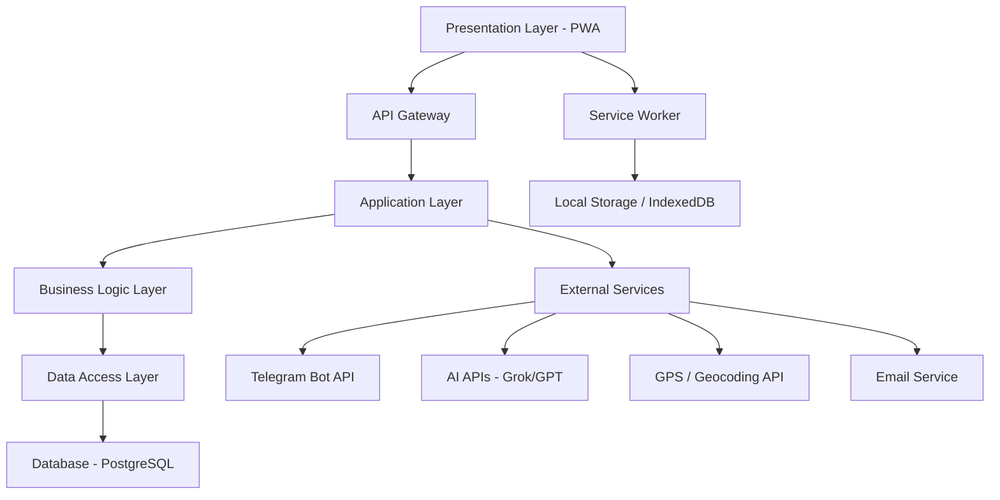
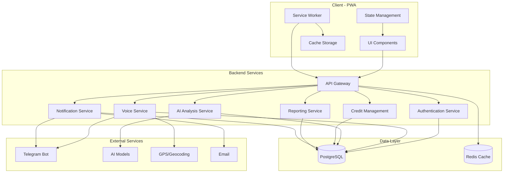
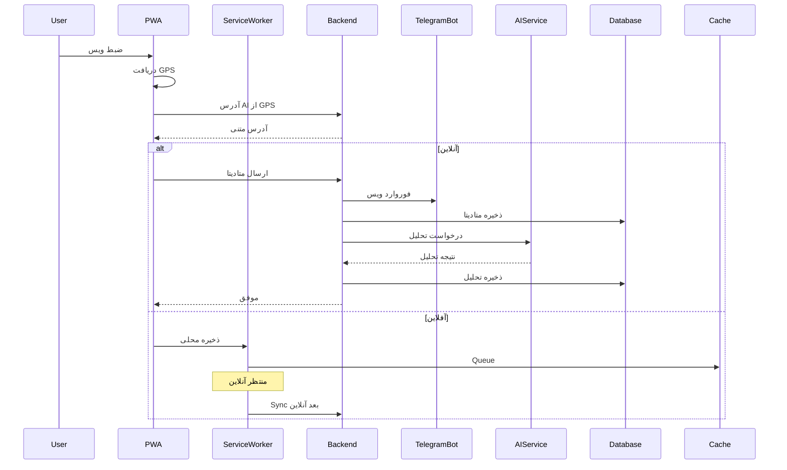
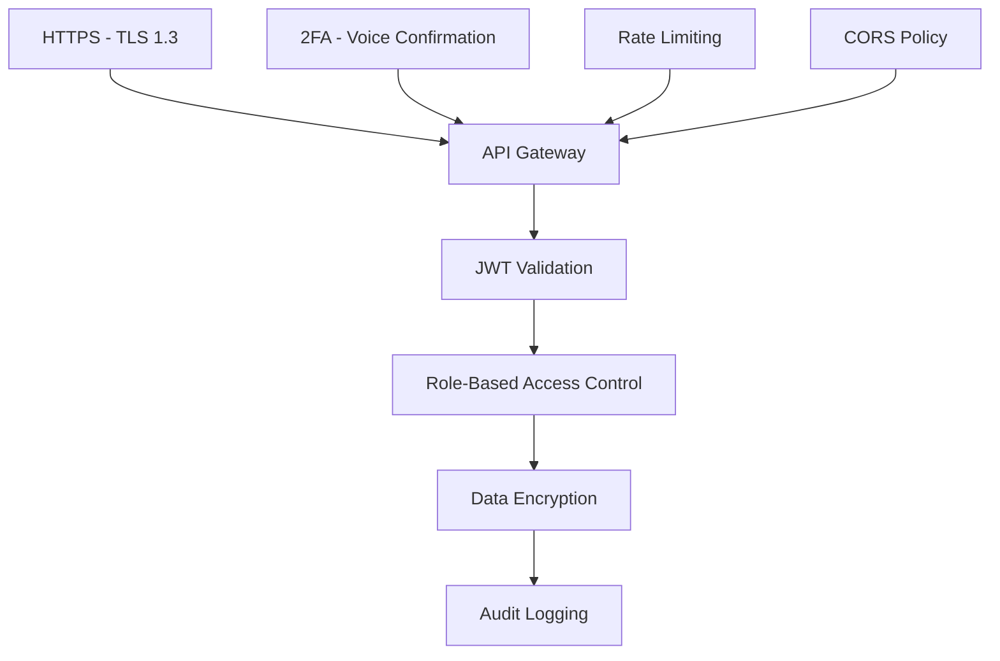
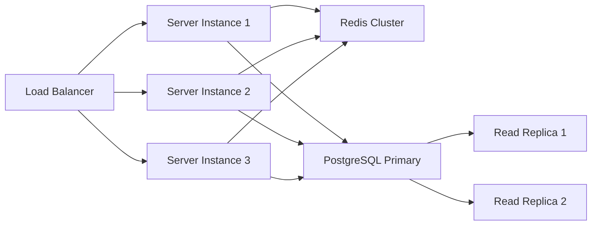
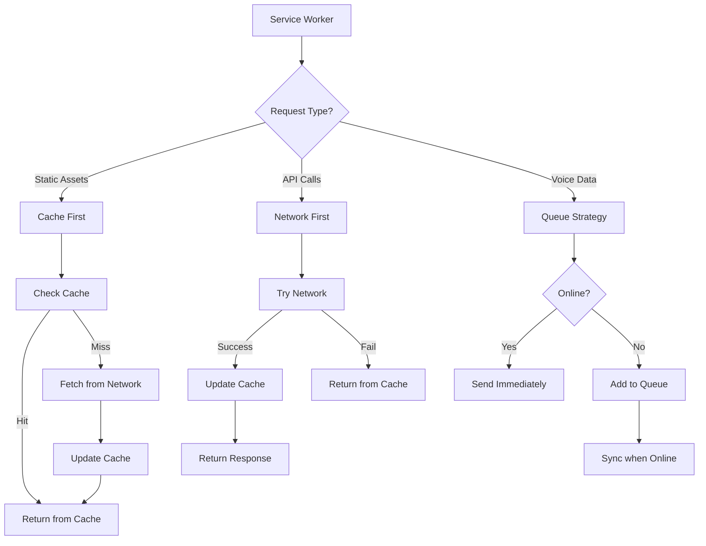
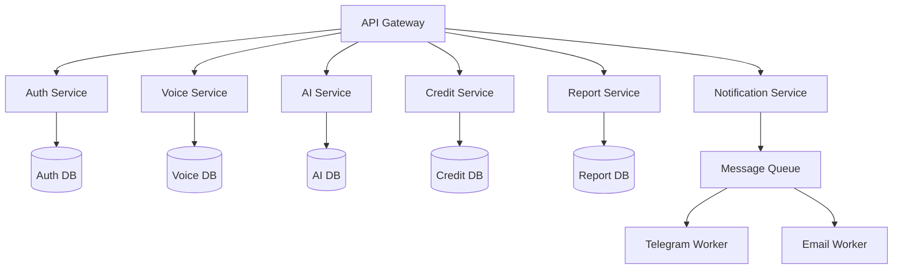
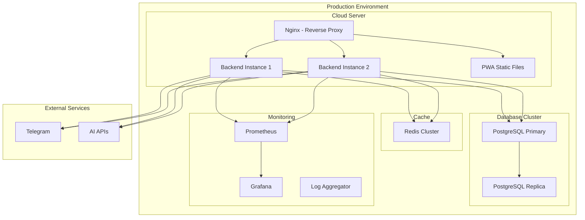

# معماری نرم‌افزار ToInfinity

**⚠️ SPECIFICATION DOCUMENT - ORIGINAL PLAN**

This document represents the **original architectural specification** from the planning phase. The actual implementation may differ.

**For current, accurate implementation details, see:**
- **[../../ARCHITECTURE_CURRENT.md](../../ARCHITECTURE_CURRENT.md)** - Complete current architecture
- **[../../README.md](../../README.md)** - Documentation index

---

## نسخه ۱.۰

---

## ۱. نمای کلی معماری

### ۱.۱ معماری لایه‌ای (Layered Architecture)

---

## ۲. معماری کامپوننت‌ها

---

## ۳. فلوی داده (Data Flow)

### ۳.۱ جریان ضبط و تحلیل ویس

---

## ۴. معماری امنیت

### ۴.۱ لایه‌های امنیتی

### ۴.۲ احراز هویت و مجوزدهی

1. **Authentication Flow**:
   - Telegram OAuth
   - JWT Token Generation
   - Refresh Token Mechanism

2. **Authorization**:
   - Role-based (USER, ADMIN)
   - Hierarchical (Manager-Employee)
   - Feature-based (تیک خاموش = غیب کامل)

3. **Data Security**:
   - Encryption at rest (GPS, Customer data)
   - Encryption in transit (HTTPS)
   - No voice storage on server
   - Anonymization for reports

---

## ۵. معماری مقیاس‌پذیری

### ۵.۱ استراتژی Scaling

### ۵.۲ Caching Strategy

1. **Redis Cache**:
   - User sessions
   - API responses
   - Frequent queries

2. **Browser Cache**:
   - Static assets
   - Service Worker cache
   - LocalStorage for offline data

3. **Database Query Optimization**:
   - Indexes
   - Query optimization
   - Materialized views

---

## ۶. معماری PWA

### ۶.۱ Service Worker Strategy

---

## ۷. معماری میکروسرویس‌ها (اختیاری برای آینده)

### ۷.۱ تقسیم به میکروسرویس‌ها

---

## ۸. API Design

### ۸.۱ RESTful Endpoints

| Method | Endpoint | توضیح |
|--------|----------|-------|
| POST | /auth/telegram | ورود با تلگرام |
| POST | /auth/refresh | Refresh token |
| GET | /users | لیست کاربران |
| GET | /users/:id | جزئیات کاربر |
| POST | /voice/record | ارسال متادیتای ویس |
| POST | /ai/analyze | درخواست تحلیل |
| GET | /ai/results/:id | نتیجه تحلیل |
| POST | /credit/request | درخواست اعتباری |
| POST | /credit/approve | تأیید اعتباری |
| GET | /reports/educational | گزارشات آموزشی |
| GET | /reports/financial | گزارشات مالی |
| POST | /notifications | ارسال نوتیفیکیشن |

### ۸.۲ WebSocket Endpoints

| Event | توضیح |
|-------|-------|
| dashboard:update | بروزرسانی زنده داشبورد |
| notification:new | نوتیفیکیشن جدید |
| debt:alert | هشدار مانده |
| gps:alert | هشدار GPS کالای فراموش شده |

---

## ۹. دیاگرام استقرار (Deployment)

---

## ۱۰. تکنولوژی‌های پیشنهادی

### ۱۰.۱ Frontend

| Component | Technology | دلیل انتخاب |
|-----------|-----------|------------|
| Framework | React / Vue | PWA support, Community |
| State Management | Redux / Vuex | Centralized state |
| UI Library | Material-UI / Vuetify | RTL support, Persian |
| PWA | Workbox | Service Worker management |
| Build Tool | Vite | Fast build, Modern |

### ۱۰.۲ Backend

| Component | Technology | دلیل انتخاب |
|-----------|-----------|------------|
| Runtime | Node.js / Python | AI integration, Fast |
| Framework | Express / FastAPI | Lightweight, Flexible |
| ORM | Prisma / SQLAlchemy | Type-safe, Migrations |
| API Docs | Swagger / OpenAPI | Auto-generated docs |
| Background Jobs | Bull / Celery | Queue management |

### ۱۰.۳ Database

| Component | Technology | دلیل انتخاب |
|-----------|-----------|------------|
| Primary DB | PostgreSQL 14+ | JSONB support, Reliable |
| Cache | Redis | Fast, In-memory |
| Search | PostgreSQL Full-Text | Built-in, No extra service |

### ۱۰.۴ DevOps

| Component | Technology | دلیل انتخاب |
|-----------|-----------|------------|
| Container | Docker | Consistency |
| Orchestration | Docker Compose / K8s | Scaling |
| CI/CD | GitHub Actions | Integrated |
| Monitoring | Prometheus + Grafana | Open-source, Powerful |
| Logging | ELK / Loki | Centralized logs |

---

**تاریخ**: ۱۴۰۳/۰۹/۲۱
**نسخه**: ۱.۰
**وضعیت**: نهایی
