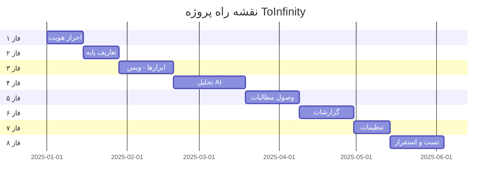
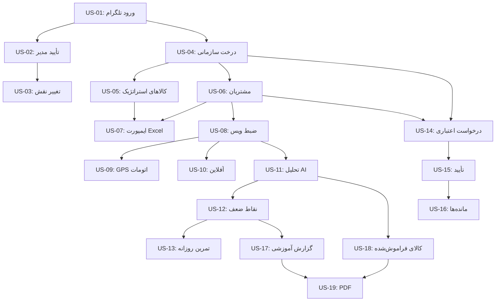

# نقشه راه پروژه ToInfinity

## نسخه ۱.۰

---

## ۱. Timeline کلی

---

## ۲. Milestones

### Milestone 1: احراز هویت (هفته ۲)
✅ **تاریخ هدف**: پایان هفته ۲
- [ ] ربات تلگرام فعال
- [ ] ورود با Telegram OAuth
- [ ] تأیید مدیر
- [ ] JWT Token
- [ ] انتخاب زبان

### Milestone 2: تعاریف (هفته ۴)
✅ **تاریخ هدف**: پایان هفته ۴
- [ ] سلسله مراتب سازمانی
- [ ] مدیریت کالا
- [ ] مدیریت مشتری
- [ ] ایمپورت Excel

### Milestone 3: ضبط ویس (هفته ۷)
✅ **تاریخ هدف**: پایان هفته ۷
- [ ] فرم پیش از ضبط
- [ ] ضبط ویس با GPS
- [ ] شناسایی صدا
- [ ] فوروارد تلگرام
- [ ] آفلاین Sync

### Milestone 4: تحلیل AI (هفته ۱۱)
✅ **تاریخ هدف**: پایان هفته ۱۱
- [ ] اتصال AI APIs
- [ ] تحلیل ۶ موضوع
- [ ] نمره‌دهی
- [ ] تمرین‌های روزانه
- [ ] بودجه API

### Milestone 5: وصول مطالبات (هفته ۱۴)
✅ **تاریخ هدف**: پایان هفته ۱۴
- [ ] درخواست اعتباری
- [ ] تأیید رده‌ای
- [ ] مدیریت مانده
- [ ] نوتیفیکیشن‌های مالی

### Milestone 6: گزارشات (هفته ۱۷)
✅ **تاریخ هدف**: پایان هفته ۱۷
- [ ] ۴ دسته گزارش
- [ ] خروجی PDF
- [ ] ارسال به تلگرام
- [ ] فیلترهای سلسله‌مراتبی

### Milestone 7: تنظیمات (هفته ۱۹)
✅ **تاریخ هدف**: پایان هفته ۱۹
- [ ] ویزارد نصب
- [ ] پیکربندی API
- [ ] دسترسی‌ها
- [ ] مشخصات شرکت

### Milestone 8: Launch (هفته ۲۲)
✅ **تاریخ هدف**: پایان هفته ۲۲
- [ ] تست کامل
- [ ] UAT
- [ ] Deploy Production
- [ ] آموزش کاربران

---

## ۳. Backlog کامل

### Epic 1: Authentication & Authorization
**Priority**: بحرانی

#### User Stories:
1. **US-01**: به عنوان کاربر، می‌خواهم با تلگرام وارد شوم
   - Acceptance Criteria:
     - کلیک روی لینک ربات
     - /start در تلگرام
     - دریافت JWT
   - Effort: 3 روز
   - Dependencies: ندارد

2. **US-02**: به عنوان مدیر، می‌خواهم کاربران جدید را تأیید کنم
   - Acceptance Criteria:
     - دریافت نوتیفیکیشن
     - تأیید با ویس یا چک‌باکس
     - کاربر active می‌شود
   - Effort: 2 روز
   - Dependencies: US-01

3. **US-03**: به عنوان ادمین اولیه، می‌خواهم نقش کاربران را تغییر دهم
   - Acceptance Criteria:
     - فقط ادمین اولیه
     - تأیید با ویس
     - Log تغییر
   - Effort: 2 روز
   - Dependencies: US-01, US-02

### Epic 2: Definitions Module
**Priority**: بحرانی

#### User Stories:
4. **US-04**: به عنوان ادمین، می‌خواهم درخت سازمانی بسازم
   - Effort: 3 روز

5. **US-05**: به عنوان ادمین، می‌خواهم کالاهای استراتژیک تعریف کنم
   - Effort: 2 روز

6. **US-06**: به عنوان ادمین، می‌خواهم مشتریان را مدیریت کنم
   - Effort: 2 روز

7. **US-07**: به عنوان کاربر، می‌خواهم از Excel ایمپورت کنم
   - Effort: 3 روز

### Epic 3: Voice Tools
**Priority**: بحرانی

#### User Stories:
8. **US-08**: به عنوان فروشنده، می‌خواهم مذاکره را ضبط کنم
   - Effort: 5 روز

9. **US-09**: به عنوان فروشنده، می‌خواهم GPS اتومات دریافت کنم
   - Effort: 2 روز

10. **US-10**: به عنوان فروشنده، می‌خواهم آفلاین کار کنم
    - Effort: 4 روز

### Epic 4: AI Analysis
**Priority**: بالا

#### User Stories:
11. **US-11**: به عنوان کاربر، می‌خواهم مذاکره‌ام تحلیل شود
    - Effort: 7 روز

12. **US-12**: به عنوان کاربر، می‌خواهم نقاط ضعفم را ببینم
    - Effort: 3 روز

13. **US-13**: به عنوان کاربر، می‌خواهم تمرین روزانه داشته باشم
    - Effort: 3 روز

### Epic 5: Credit Management
**Priority**: بالا

#### User Stories:
14. **US-14**: به عنوان فروشنده، می‌خواهم درخواست اعتباری بدهم
    - Effort: 3 روز

15. **US-15**: به عنوان مدیر، می‌خواهم درخواست را تأیید کنم
    - Effort: 3 روز

16. **US-16**: به عنوان کاربر، می‌خواهم مانده‌هایم را ببینم
    - Effort: 2 روز

### Epic 6: Reporting
**Priority**: متوسط

#### User Stories:
17. **US-17**: به عنوان کاربر، می‌خواهم گزارش آموزشی ببینم
    - Effort: 3 روز

18. **US-18**: به عنوان کاربر، می‌خواهم کالاهای فراموش‌شده را ببینم
    - Effort: 3 روز

19. **US-19**: به عنوان کاربر، می‌خواهم PDF به تلگرام بفرستم
    - Effort: 2 روز

---

## ۴. Dependencies Graph

---

## ۵. Release Plan

### Release 1.0 - MVP (هفته ۱۱)
**Features**:
- ✅ احراز هویت کامل
- ✅ تعاریف پایه
- ✅ ضبط ویس با GPS
- ✅ تحلیل AI اولیه (۳ موضوع)
- ✅ گزارش ساده

**Target**: شرکت پایلوت (۱۰ نفر)

### Release 1.1 - Enhanced (هفته ۱۴)
**Features**:
- ✅ تحلیل AI کامل (۶ موضوع)
- ✅ وصول مطالبات
- ✅ گزارشات ۴ دسته

**Target**: شرکت پایلوت (۵۰ نفر)

### Release 1.2 - Full (هفته ۱۹)
**Features**:
- ✅ تنظیمات کامل
- ✅ دسترسی‌های رده‌ای
- ✅ چندزبانه

**Target**: چند شرکت (۲۰۰ نفر)

### Release 2.0 - Scale (هفته ۲۲+)
**Features**:
- ✅ بهینه‌سازی عملکرد
- ✅ Microservices (اختیاری)
- ✅ Advanced Analytics

**Target**: بازار عمومی

---

## ۶. Risks & Mitigation

| Risk | احتمال | تأثیر | راه‌حل |
|------|--------|-------|--------|
| تأخیر در AI Integration | متوسط | بالا | Mock data, Parallel dev |
| مشکل Telegram API | پایین | بالا | Fallback به Email |
| GPS غیردقیق | بالا | متوسط | ورود دستی |
| مقاومت کاربران | بالا | بالا | آموزش, تست UAT |
| Budget Overrun | متوسط | متوسط | MVP اول, Feature toggle |

---

**تاریخ**: ۱۴۰۳/۰۹/۲۱
**نسخه**: ۱.۰
**وضعیت**: نهایی
