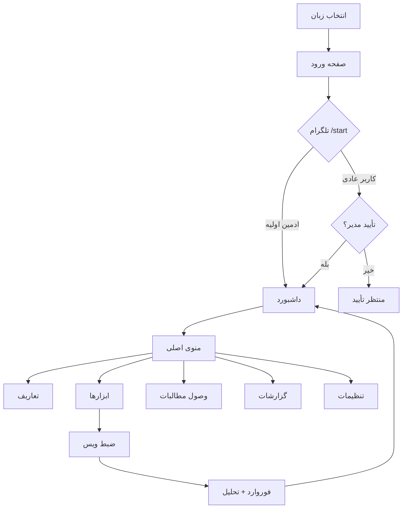

# طراحی رابط کاربری و تجربه کاربری (UI/UX)
# سیستم ToInfinity

## نسخه ۱.۰

---

## ۱. اصول طراحی

### ۱.۱ اصول کلی
- **سادگی**: رابط ساده و بدون پیچیدگی
- **شخصی‌سازی**: بر اساس نقش و دسترسی
- **تیک خاموش = غیب کامل**: اگر دسترسی خاموش، بخش نمایش نمی‌شود
- **RTL**: پشتیبانی کامل از فارسی (راست به چپ)
- **PWA**: نصب بدون اپ استور
- **Responsive**: سازگار با موبایل و تبلت

### ۱.۲ پالت رنگی (پیشنهادی)
- **Primary**: #1976D2 (آبی)
- **Secondary**: #388E3C (سبز)
- **Error**: #D32F2F (قرمز)
- **Warning**: #F57C00 (نارنجی)
- **Success**: #388E3C (سبز)
- **Background**: #FAFAFA (خاکستری روشن)

---

## ۲. صفحه انتخاب زبان (اولین صفحه)

### Layout:
```
┌─────────────────────────────────────┐
│                                      │
│         Logo ToInfinity              │
│                                      │
│      انتخاب زبان خود را انجام دهید   │
│                                      │
│     ┌─────────────────┐              │
│     │     فارسی       │              │
│     └─────────────────┘              │
│                                      │
│     ┌─────────────────┐              │
│     │    English      │              │
│     └─────────────────┘              │
│                                      │
│     ┌─────────────────┐              │
│     │    العربية      │              │
│     └─────────────────┘              │
│                                      │
└─────────────────────────────────────┘
```

### عناصر:
- لوگوی شرکت (بالا، وسط)
- عنوان (H1): "انتخاب زبان"
- ۳ دکمه بزرگ برای زبان‌ها
- هیچ منوی یا گزینه دیگری

### رفتار:
- کلیک روی هر زبان → ذخیره در localStorage + cookie
- انتقال به صفحه ورود

---

## ۳. صفحه ورود / ثبت‌نام

### Layout:
```
┌─────────────────────────────────────┐
│  [تنظیمات زبان]                Logo │
├─────────────────────────────────────┤
│                                      │
│           به ToInfinity خوش آمدید   │
│                                      │
│     برای ورود، روی لینک زیر کلیک    │
│         کنید و در تلگرام /start     │
│                بزنید                 │
│                                      │
│     ┌─────────────────┐              │
│     │  🔗 ورود با تلگرام │            │
│     └─────────────────┘              │
│                                      │
│         https://t.me/ToInfinityBot   │
│                                      │
└─────────────────────────────────────┘
```

### عناصر:
- آیکون تنظیمات زبان (بالا، چپ/راست بسته به RTL)
- لوگو (بالا، راست/چپ)
- عنوان خوش‌آمدگویی
- توضیح مختصر
- دکمه "ورود با تلگرام" (آیکون تلگرام)
- لینک ربات

### رفتار:
- کلیک روی دکمه → باز کردن تلگرام
- بعد از /start در تلگرام → redirect به داشبورد
- اگر pending_manager → نمایش "در انتظار تأیید مدیر"

---

## ۴. داشبورد

### Layout:
```
┌─────────────────────────────────────┐
│ ☰ Menu  │  Dashboard  │  🔔 نوتیف  │
├─────────────────────────────────────┤
│                                      │
│  ┌────────────────────────────────┐ │
│  │  نمره: 75/100      سطح: نیمه   │ │
│  │  [████████░░] پیشرفت            │ │
│  └────────────────────────────────┘ │
│                                      │
│  ┌────────────────────────────────┐ │
│  │  تمرین امروز (اولویت اول)     │ │
│  │  ◉ تمرین ۱: لحن آرامش (۳/۵)   │ │
│  │  ○ تمرین ۲: ...                │ │
│  │  ○ تمرین ۳: ...                │ │
│  └────────────────────────────────┘ │
│                                      │
│  ┌────────────────────────────────┐ │
│  │  گراف پیشرفت (هفتگی)          │ │
│  │  [نمودار خطی]                  │ │
│  └────────────────────────────────┘ │
│                                      │
│  ┌────────────────────────────────┐ │
│  │  🔔 نوتیفیکیشن‌ها:             │ │
│  │  • مانده معوق: مشتری X         │ │
│  │  • کالای فراموش‌شده: Y         │ │
│  │  • هشدار به مدیر: Z            │ │
│  └────────────────────────────────┘ │
│                                      │
└─────────────────────────────────────┘
```

### عناصر:
- Hamburger Menu (چپ)
- عنوان صفحه (وسط)
- آیکون نوتیفیکیشن با Badge (راست)
- کارت نمره و سطح
- کارت تمرین‌های روزانه
- گراف پیشرفت
- لیست نوتیفیکیشن‌های اخیر

### رفتار:
- بروزرسانی زنده با WebSocket
- فقط بخش‌های تیک‌دار نمایش
- کلیک روی نوتیفیکیشن → جزئیات

---

## ۵. منوی سایدبار

### Layout:
```
┌──────────────────┐
│                   │
│  👤 نام کاربر     │
│     نقش: ادمین    │
│                   │
├──────────────────┤
│  🏠 داشبورد       │
│  📋 تعاریف        │
│  🎤 ابزارها       │
│  💰 وصول مطالبات  │
│  📊 گزارشات       │
│  ⚙️ تنظیمات       │
│  📖 راهنما        │
├──────────────────┤
│  🚪 خروج         │
└──────────────────┘
```

### رفتار:
- فقط آیتم‌های تیک‌دار نمایش
- تیک خاموش = غیب کامل
- کلیک روی هر آیتم → صفحه مربوطه

---

## ۶. صفحه تعاریف

### Layout (زیرمنو):
```
┌─────────────────────────────────────┐
│ ☰   تعاریف                       🔔 │
├─────────────────────────────────────┤
│                                      │
│  Tabs:                               │
│  [سلسله مراتب] [کالا] [مشتری]       │
│                                      │
│  ┌────────────────────────────────┐ │
│  │  درخت سازمانی (Tree View):     │ │
│  │                                 │ │
│  │  ▼ مدیرعامل                    │ │
│  │    ▼ مدیر فروش                 │ │
│  │      • فروشنده ۱               │ │
│  │      • فروشنده ۲               │ │
│  │    ▶ مدیر مالی                 │ │
│  │                                 │ │
│  │  [+ افزودن رده]                │ │
│  └────────────────────────────────┘ │
│                                      │
│  [ویرایش] [حذف]                     │
│                                      │
└─────────────────────────────────────┘
```

### عناصر:
- Tabs برای سلسله مراتب، گروه کالا، برند، کالاها، صنف، مشتری
- درخت سازمانی (قابل expand/collapse)
- دکمه‌های افزودن، ویرایش، حذف
- دکمه ایمپورت Excel

---

## ۷. صفحه ابزارها - ضبط ویس

### Layout (قبل از ضبط):
```
┌─────────────────────────────────────┐
│ ☰   ابزارها - مذاکره              🔔│
├─────────────────────────────────────┤
│                                      │
│  ┌────────────────────────────────┐ │
│  │  نام مشتری *                   │ │
│  │  [_________________]            │ │
│  │                                 │ │
│  │  صنف مشتری *                   │ │
│  │  [▼ انتخاب کنید ________]      │ │
│  │                                 │ │
│  └────────────────────────────────┘ │
│                                      │
│     ┌─────────────────┐              │
│     │   🎤 ضبط ویس    │  (خاکستری)  │
│     └─────────────────┘              │
│                                      │
└─────────────────────────────────────┘
```

### Layout (در حال ضبط):
```
┌─────────────────────────────────────┐
│ ☰   ابزارها - مذاکره              🔔│
├─────────────────────────────────────┤
│                                      │
│  ┌────────────────────────────────┐ │
│  │  در حال ضبط...                │ │
│  │                                 │ │
│  │      [●] 00:03:24               │ │
│  │                                 │ │
│  │  📍 GPS: تهران، خیابان آزادی    │ │
│  │     دقت: 8 متر ✓                │ │
│  │                                 │ │
│  └────────────────────────────────┘ │
│                                      │
│     ┌─────────────────┐              │
│     │   ⏹ توقف ضبط    │  (قرمز)     │
│     └─────────────────┘              │
│                                      │
└─────────────────────────────────────┘
```

### رفتار:
- تا فیلدها پر نشوند، دکمه ضبط غیرفعال
- در حال ضبط: نمایش timer و GPS
- بعد از توقف: شناسایی صدا → فوروارد
- نوتیفیکیشن موفقیت

---

## ۸. صفحه وصول مطالبات

### Layout:
```
┌─────────────────────────────────────┐
│ ☰   وصول مطالبات                  🔔│
├─────────────────────────────────────┤
│                                      │
│  Tabs:                               │
│  [درخواست] [تأیید] [مانده من]      │
│                                      │
│  ─── درخواست اعتباری ───             │
│                                      │
│  کد مشتری: [_____]                  │
│  مبلغ: [_______] تومان              │
│  تاریخ تسویه: [📅 انتخاب]          │
│  ضامن: [▼ انتخاب _____]            │
│                                      │
│  ┌─────────────────┐                 │
│  │  ثبت درخواست    │                 │
│  └─────────────────┘                 │
│                                      │
│  ─── درخواست‌های من ───              │
│                                      │
│  ┌────────────────────────────────┐ │
│  │ مشتری: X | مبلغ: 10M | معلق    │ │
│  │ رده B: ✓  رده C: ...  رده D: - │ │
│  └────────────────────────────────┘ │
│                                      │
└─────────────────────────────────────┘
```

### عناصر:
- Tabs برای درخواست، تأیید، مانده
- فرم درخواست
- لیست درخواست‌های کاربر با وضعیت تأیید
- نمایش رده‌های تأییدکننده

---

## ۹. صفحه گزارشات

### Layout:
```
┌─────────────────────────────────────┐
│ ☰   گزارشات                        🔔│
├─────────────────────────────────────┤
│                                      │
│  دسته‌بندی:                          │
│  ○ آموزشی                           │
│  ○ ابلاغ‌ها و درخواست‌ها            │
│  ○ ارجاعات سازمانی                  │
│  ○ تأییدها و مانده‌ها               │
│                                      │
│  ─── گزارش نقاط ضعف ───             │
│                                      │
│  ┌────────────────────────────────┐ │
│  │  کاربر │ کلام │ لحن │ استرس   │ │
│  ├────────────────────────────────┤ │
│  │  علی   │  65  │ 75  │  80     │ │
│  │  رضا   │  70  │ 60  │  70     │ │
│  └────────────────────────────────┘ │
│                                      │
│  ┌─────────────────┐                 │
│  │ 📤 ارسال به تلگرام │               │
│  └─────────────────┘                 │
│                                      │
└─────────────────────────────────────┘
```

### عناصر:
- Radio buttons برای دسته‌بندی
- جدول گزارش
- فیلترهای تاریخ، کاربر (سلسله‌مراتبی)
- دکمه ارسال PDF به تلگرام

---

## ۱۰. صفحه تنظیمات

### Layout:
```
┌─────────────────────────────────────┐
│ ☰   تنظیمات                        🔔│
├─────────────────────────────────────┤
│                                      │
│  Accordion/Tabs:                     │
│  ▼ عمومی                             │
│  ▶ API هوش مصنوعی                   │
│  ▶ دسترسی‌ها                        │
│  ▶ مشخصات شرکت                      │
│                                      │
│  ─── عمومی ───                       │
│                                      │
│  دامنه: [https://____________]      │
│  توکن ربات: [______________]        │
│  لینک ربات: [https://t.me/___]     │
│                                      │
│  زبان: [▼ فارسی ____]               │
│                                      │
│  سخت‌گیری AI:                       │
│  ○ ساده  ⦿ معمولی  ○ سخت           │
│                                      │
│  بودجه ماهانه: [____] تومان         │
│                                      │
│  [💾 ذخیره]                         │
│                                      │
└─────────────────────────────────────┘
```

### عناصر:
- Accordion یا Tabs برای دسته‌بندی
- فرم‌های تنظیمات
- دکمه تست (برای API، تلگرام)
- دکمه ذخیره

---

## ۱۱. کامپوننت‌های مشترک

### ۱۱.۱ Header
- آیکون منو (چپ)
- عنوان صفحه (وسط)
- آیکون نوتیفیکیشن (راست)

### ۱۱.۲ Bottom Navigation (موبایل)
```
[🏠 داشبورد] [🎤 ابزارها] [📊 گزارشات] [⚙️ تنظیمات]
```

### ۱۱.۳ نوتیفیکیشن Toast
```
┌─────────────────────────────┐
│ ✓ عملیات با موفقیت انجام شد │
└─────────────────────────────┘
```

### ۱۱.۴ دیالوگ تأیید
```
┌─────────────────────────────┐
│  آیا مطمئن هستید؟            │
│                              │
│  [لغو]        [تأیید]       │
└─────────────────────────────┘
```

---

## ۱۲. جریان کاربر (User Flow)



---

## ۱۳. Accessibility

### ۱۳.۱ قوانین دسترسی‌پذیری
- **Contrast Ratio**: حداقل 4.5:1
- **Font Size**: حداقل 14px
- **Touch Target**: حداقل 44x44 px
- **Keyboard Navigation**: پشتیبانی کامل
- **Screen Reader**: سازگاری با NVDA, JAWS

### ۱۳.۲ ARIA Labels
- تمام دکمه‌ها با aria-label
- فرم‌ها با aria-describedby
- نوتیفیکیشن‌ها با role="alert"

---

## ۱۴. توصیه‌های پیاده‌سازی

### Frontend Framework:
- **React** با Material-UI (RTL support)
- یا **Vue** با Vuetify

### UI Library:
- Material Design با تم شخصی‌سازی‌شده
- پشتیبانی کامل RTL

### Icons:
- Material Icons یا Font Awesome

### Animations:
- استفاده محدود و هدفمند
- Fade, Slide برای transition

---

**تاریخ**: ۱۴۰۳/۰۹/۲۱
**نسخه**: ۱.۰
**وضعیت**: نهایی
